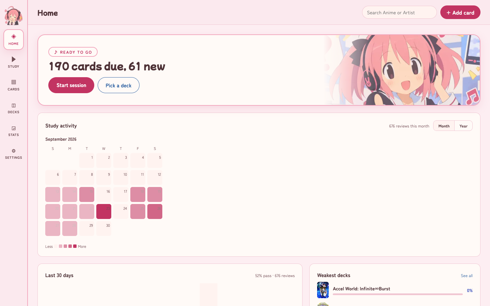
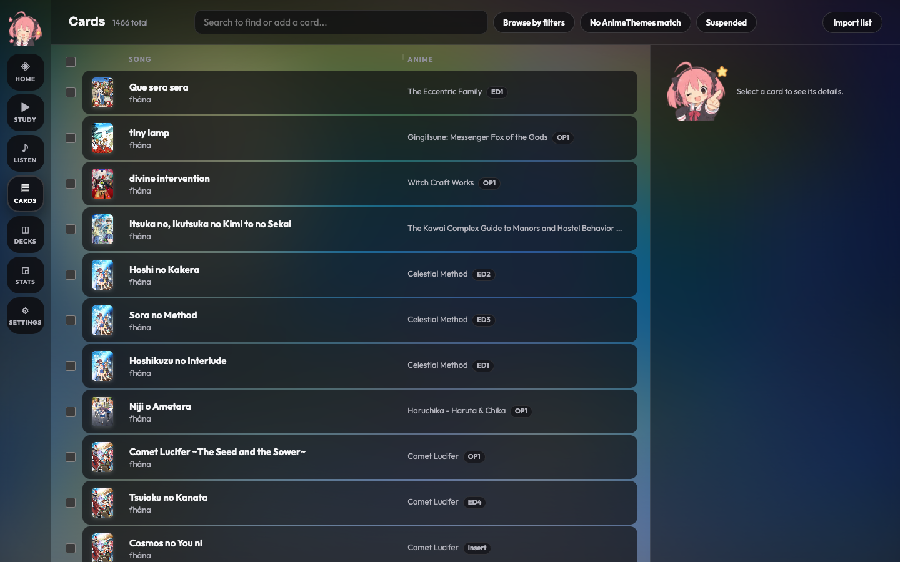
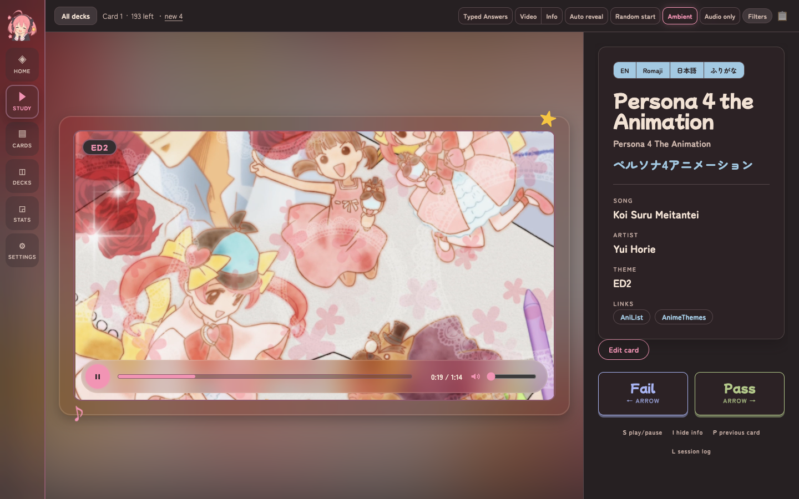
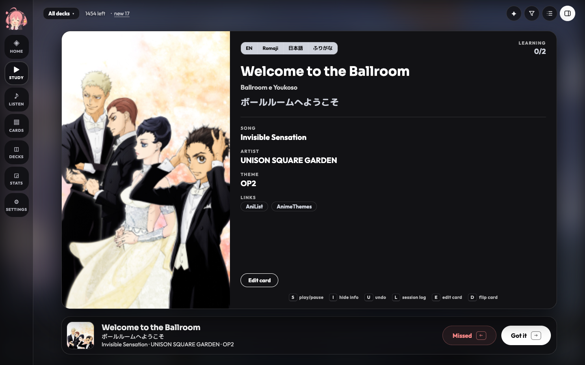
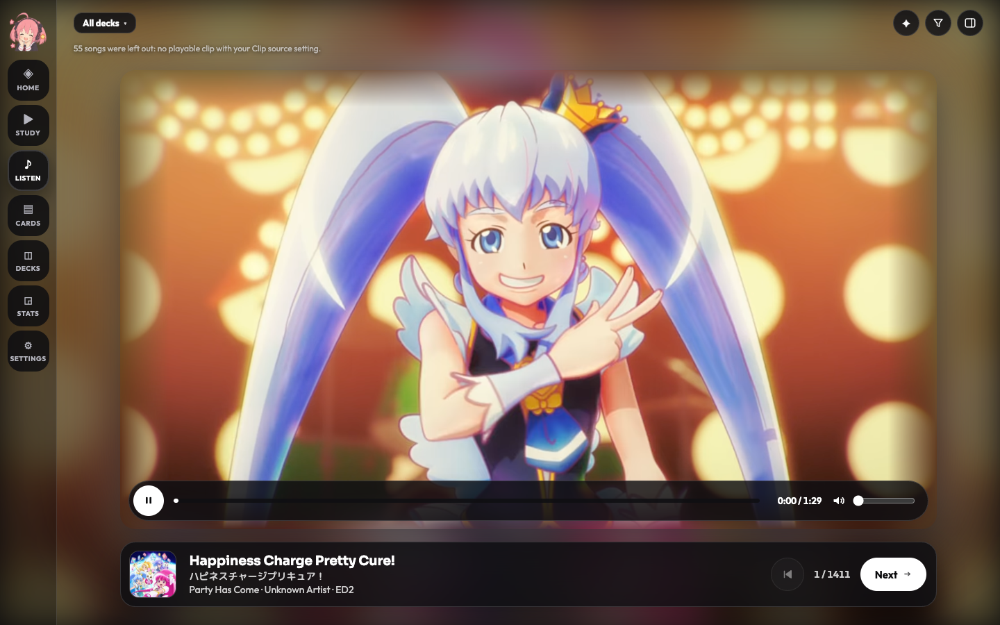
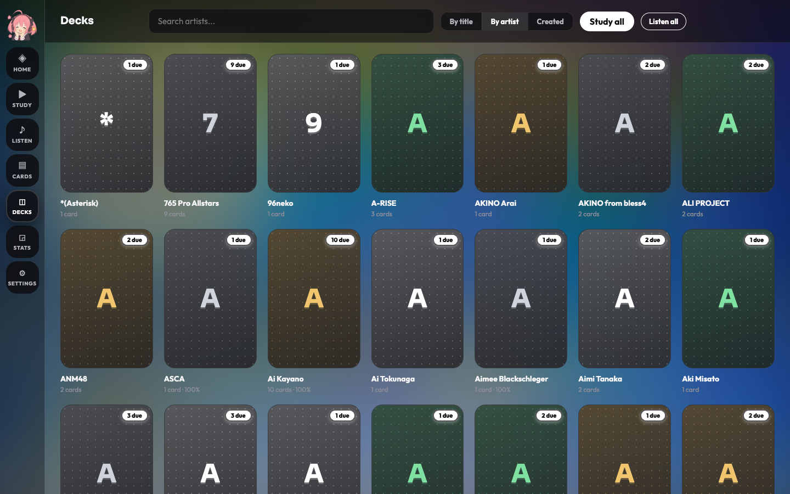
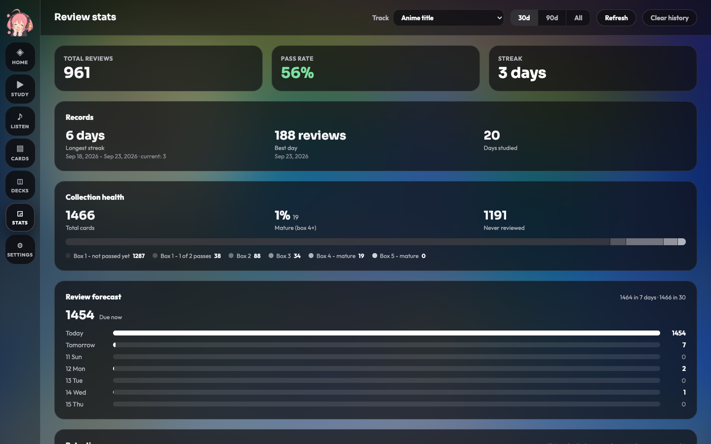

  

# GAQ SRS

**Get better at Anime Music Quiz, one song at a time.**

If you've played [Anime Music Quiz](https://animemusicquiz.com), you know the
feeling: a song starts, it sounds *so* familiar, and the timer runs out before
the name comes back to you. GAQ SRS is built for exactly that.

It's a flashcard app for anime songs. You hear a clip, try to name the show,
and the app remembers how it went. Songs you miss come back soon, and songs you
know get pushed further out. Over time, the ones that used to stump you start
landing in the first few seconds.

Everything runs on your own computer. No account, no cloud, just you and your
playlist.

  

## How it works

### 1. Add the songs you want to learn

Search for an anime, a song, or an artist, and add the openings and endings you
want to practice. You can grab one song, a whole show, or everything an artist
has sung.

  

### 2. Listen and guess

Hit **Start session** and the clips start playing. Take your guess, reveal the
answer, and mark whether you got it. That's the whole loop. Hide the video if
you want to go by ear alone, or type your answers if you want it to feel like
the real game.

  

Press `D`, or click the empty space beside the video, to flip the picture over
and see the answer, the cover art, notes, and links out to AniList and
AnimeThemes.

  

### 3. Just listen

Not in the mood to grade yourself? **Listen** plays a deck, or your whole
library, in order or shuffled, with the same player and Hide Video and Hide Info
toggles but no scoring. It's handy for warming up or hosting a guessing round
without the party server.

Turn on **Mix** and Listen crossfades from one song into the next, with a choice
of fade length and curve, and the pictures dissolve into each other too.

  

### 4. Focus on what you want

Your songs sort themselves into decks by anime and by artist, and you can make
your own too. Want to drill one show before a themed lobby? Just study that
deck.

  

### 5. Watch yourself improve

Keep an eye on your pass rate, your streak, and what's coming up next, so you
can see it actually sticking.

  

### 6. Learn the kanji in the titles

Turn on **Japanese breakdown** in Settings and a second flip card shows each
native title kanji by kanji: an English keyword, its component parts, readings,
stroke count, and your own memory story (or a default one if you haven't written
one). Tap any kanji or part to drill into it, switch the text to all hiragana or
all katakana, and search for any kanji by character or keyword.

Add kanji to your personal **Kanji Study** deck and review them with the same
spaced-repetition boxes as your songs, while the song each kanji came from plays
in the background.

## More ways to tune it

- **Typed answers**: type the anime name (with suggestions) for points and a
  combo, and optionally the song, artist, or OP/ED number too. You can set what
  each deck is graded on.
- **Filters**: narrow any session by year, season, score, format, genre, tag,
  OP/ED/Insert, or the Completed list of an AniList or MyAnimeList user.
- **Bulk adding**: browse AniList by filters, import a whole Completed list,
  or pull in everything an artist has sung, then drop the results into a deck.
- **Known, Learning, Suspended**: mark songs you already know so they leave the
  queue, or park a card for later. Undo your last review if you slip.
- **Your keys**: every Study, Listen, and Preview hotkey can be rebound in
  Settings.
- **Light and dark** themes, plus custom pictures for your own decks.
- **Offline mode**: stop the app from contacting any provider. Songs you've
  downloaded or cached keep playing.
- **One-click updates**: Settings > About can install a new release for you.

## Party mode

GAQ SRS also comes with **Guess the Anime**, a party game for game nights and
streams. Put the display on a TV or stream it, run the show from your phone,
and see who in the room really knows their openings.

- **Players join from their phones** with just a name and can buzz in. The host
  judges each buzz and awards points, and a scoreboard and round summary show
  on the display.
- **Make it harder**: blur, pixelate, or black out the picture, mute it, let it
  decay over time, or run **lightning rounds** with blind, peek, cover, and
  clue modes. An endless queue can draw songs from outside your library at Easy,
  Medium, or Hard.
- **Host tools**: timers, banners, lobby music, kick and ban, and a command bar
  (`Shift+P`) that finds any action by name. You can drag and resize every piece
  of the display to fit your screen or stream.

Run it with the `gaq-party` program that comes in each release.

---

Grab the latest version from the
[Releases page](https://github.com/wiredPuru/Anisong-SRS/releases). Anime
details come from AniList, and song data and clips come from AnisongDB and
AnimeThemes.
